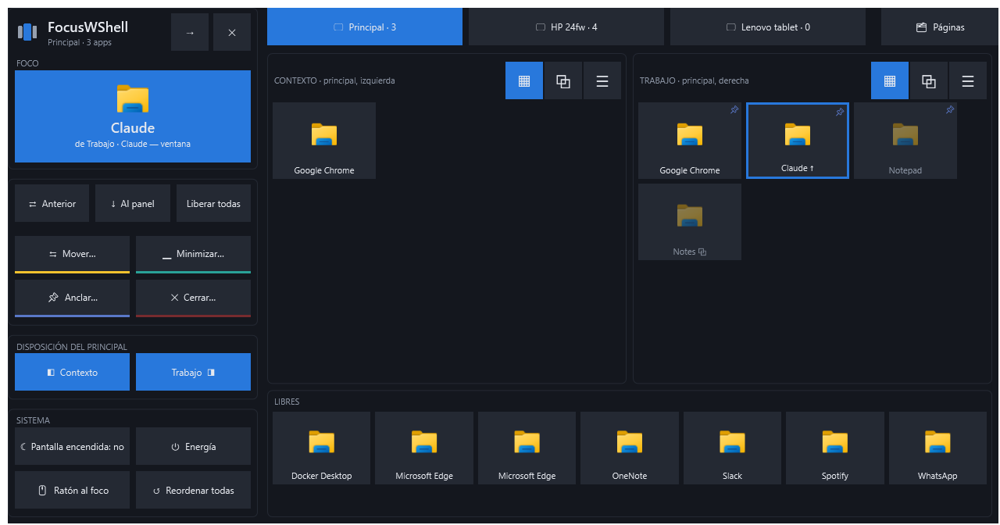
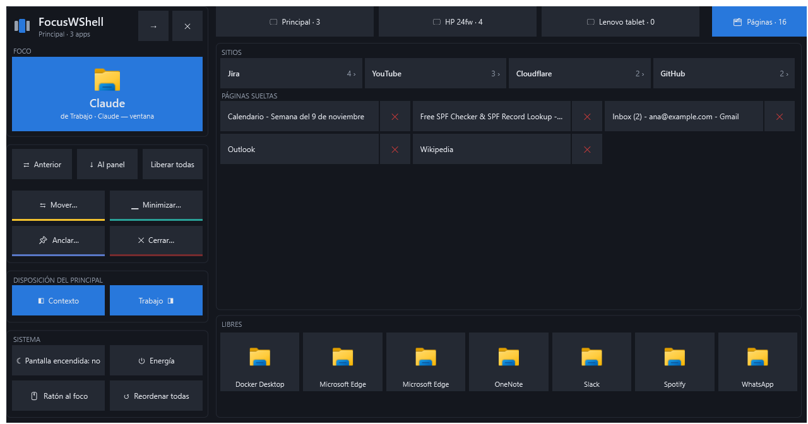
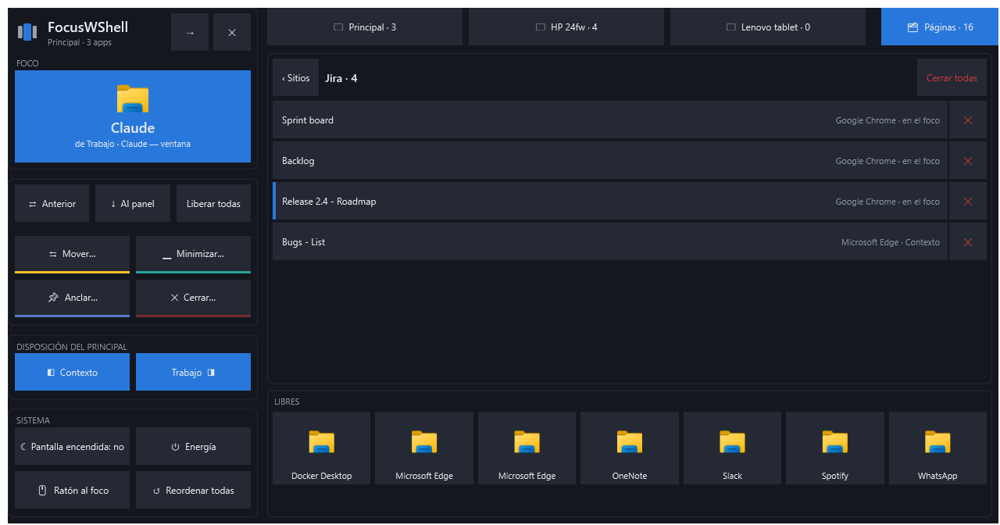

# FocusWShell

**Un gestor de atención visual para Windows.** Una app en el foco, las demás en paneles alrededor, y un deck en tu tablet para moverte entre ellas sin buscar ventanas.

[English](README.md) · [Manual](https://proteo5.github.io/FocusWShell/es/) · [Descargar](https://github.com/proteo5/FocusWShell/releases)



> **Alfa.** FocusWShell mueve tus ventanas. Está en pruebas tempranas; si algo sale mal, **Ctrl+Alt+Mayús+Retroceso** devuelve todas las ventanas a su sitio, en cualquier momento.

## Por qué

Con muchas ventanas abiertas, la que estás trabajando compite con el chat, el correo, los tableros y una docena de pestañas del navegador. FocusWShell organiza las ventanas según el papel que cumplen en tu atención, no como rectángulos en una cuadrícula:

- **Foco:** la tarea que estás haciendo, en una zona amplia y protegida del monitor principal.
- **Paneles:** las apps que tienes a mano, en columnas alrededor del foco y en tus otros monitores, en tiles, pestañas o lista.
- **Libres:** lo que no quieres organizar se queda donde está.

Una ventana sólo cambia de lugar cuando tú lo decides. Hacer clic en el chat o recibir una notificación no la lleva al foco.

## Qué hace

- **Disposición del principal.** Prende o apaga las columnas de paneles de la izquierda y la derecha, y el foco ocupa el resto: las dos columnas en un ultrawide, una en un monitor normal, o **solo foco** si tus paneles viven en otros monitores.
- **El deck.** Una superficie de control para una tablet, una pantalla táctil o una esquina de tu pantalla. Toca una app para llevarla al foco, muévela entre paneles, ánclala, ciérrala. Nunca le quita el teclado a la app en la que trabajas.
- **Páginas de los navegadores.** Todas las pestañas de Chrome y Edge en un solo lugar, agrupadas por sitio. Toca una para traerla al frente, o ciérrala, sin buscar entre ventanas.
- **Varios monitores.** Paneles en cada monitor; un monitor puede irse y volver (una tablet por wifi, la base de una laptop) y sus paneles vuelven con él.
- **Siempre reversible.** Antes de mover una ventana se escribe un diario de recuperación. Salir, el atajo de emergencia o volver a abrirlo tras una caída devuelve todas las ventanas.

| Páginas, agrupadas por sitio | Las páginas de un sitio |
| --- | --- |
|  |  |

## Instalar

1. Descarga `FocusWShell-0.3.0-alpha-win-x64.zip` desde [Releases](https://github.com/proteo5/FocusWShell/releases).
2. Descomprime todo el zip y haz doble clic en **install.cmd**.
3. FocusWShell se abre y aparece en la bandeja, junto al reloj. También está en el menú Inicio.

Necesita **Windows 10 (2004) o Windows 11, de 64 bits**, y no pide permisos de administrador. .NET va incluido. Los archivos todavía no están firmados, así que Windows puede mostrar *«Windows protegió tu PC»*: elige **Más información → Ejecutar de todas formas**.

Para desinstalar, ejecuta `uninstall.ps1` en `%LOCALAPPDATA%\Programs\FocusWShell` (clic derecho → *Ejecutar con PowerShell*). Tu configuración se queda en `%LOCALAPPDATA%\FocusWShell`, salvo que añadas `-RemoveSettings`.

## Primeros pasos

1. Abre el deck: **Ctrl+Alt+Mayús+D**, o *Deck* en el menú de la bandeja.
2. Con **Mover…**, pon tus apps en los paneles *Contexto* y *Trabajo*, y toca una app para llevarla al foco.
3. Prende o apaga las columnas de paneles en **Disposición del principal**.
4. Si tienes una tablet, manda el deck allí con **⇢** en el deck.

El [manual](https://proteo5.github.io/FocusWShell/es/) explica cada parte, los atajos y cómo usar una tablet.

## Una tablet como deck

El deck funciona en cualquier pantalla, pero luce en una tablet junto al teclado. Lo probado es **[Apollo](https://github.com/ClassicOldSong/Apollo)** en el PC y **Artemis** en una tablet Android: Apollo crea un monitor virtual con la resolución de la tablet, así que Windows la ve como una pantalla más. Moonlight (iPad) y Sunshine con un controlador de pantalla virtual deberían funcionar también, pero no se han probado.

## Privacidad

FocusWShell funciona sólo en tu PC. No se conecta a la red ni envía telemetría. Los títulos de las pestañas se leen sólo mientras la lista de *Páginas* está a la vista y nunca se guardan.

## Comentarios

Es una alfa: los problemas y las ideas son muy bienvenidos en [Issues](https://github.com/proteo5/FocusWShell/issues). Si es un problema, incluye tus monitores y su escala, y `%LOCALAPPDATA%\FocusWShell\errors.log` si existe.

## Compilar desde el código

```powershell
dotnet run --project src/FocusWShell.App
```

.NET 10 SDK en Windows. La documentación de ingeniería está en [docs/](docs/README.md), y [docs/desarrollo.md](docs/desarrollo.md) explica cómo compilar, instalar una copia de uso diario y hacer un release.

## Licencia

[Apache 2.0](LICENSE)
