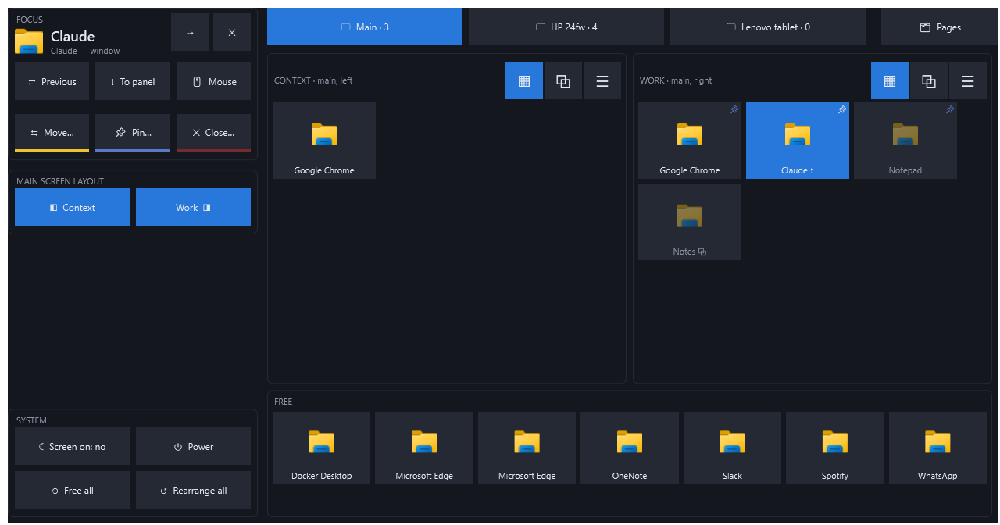
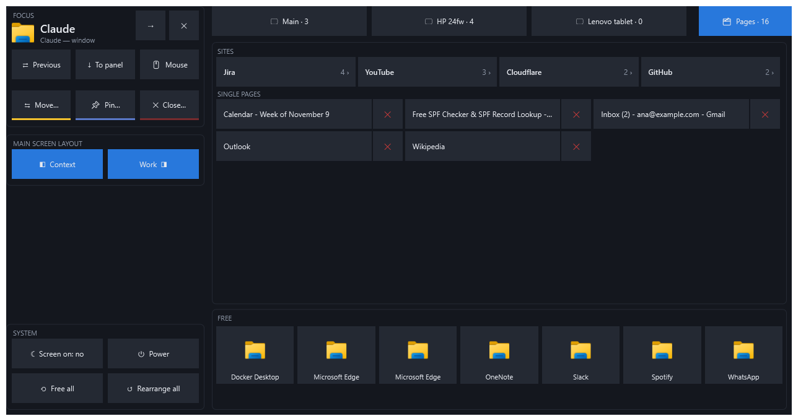
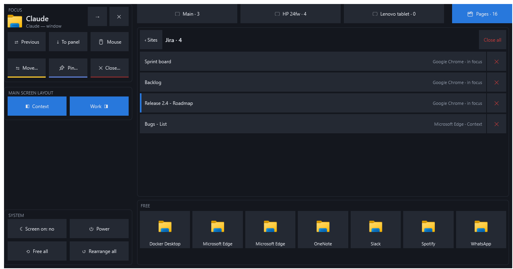

# FocusWShell

**A visual attention manager for Windows.** One app in focus, the rest in panels around it, and a deck on your tablet to move between them without hunting for windows.

[Español](README.es.md) · [Manual](https://proteo5.github.io/FocusWShell/) · [Download](https://github.com/proteo5/FocusWShell/releases)



> **Alpha.** FocusWShell moves your windows. It is in early testing; if anything goes wrong, **Ctrl+Alt+Shift+Backspace** puts every window back where it was, at any time.

## Why

With many windows open, the one you are working on competes with chat, mail, dashboards and a dozen browser tabs. FocusWShell organizes windows by the role they play in your attention, not as rectangles in a grid:

- **Focus:** the task you are doing, in a large, protected area of the main screen.
- **Panels:** the apps you keep at hand, in columns around the focus and on your other monitors, as tiles, tabs or a list.
- **Free:** what you do not want organized stays where it is.

A window only changes place when you decide. Clicking the chat or getting a notification does not bring it to the focus.

## What it does

- **Main screen layout.** Turn the left and right panel columns on or off, and the focus takes the rest: both columns on an ultrawide, one column on a regular monitor, or **focus only** when your panels live on other monitors.
- **The deck.** A control surface for a tablet, a touch screen or a corner of your screen. Tap an app to bring it to the focus, move it between panels, pin it, close it. It never steals the keyboard from the app you are working on.
- **Browser pages.** Every Chrome and Edge tab in one place, grouped by site. Tap one to bring it to the front, or close it, without searching through windows.
- **Several monitors.** Panels on each monitor; a monitor can go and come back (a tablet over Wi-Fi, a laptop dock) and its panels return with it.
- **Always reversible.** A recovery journal is written before any window moves. Exiting, the emergency shortcut, or reopening after a crash puts every window back.

| Pages, grouped by site | The pages of one site |
| --- | --- |
|  |  |

## Install

1. Download `FocusWShell-0.1.0-alpha-win-x64.zip` from [Releases](https://github.com/proteo5/FocusWShell/releases).
2. Extract the whole zip and double-click **install.cmd**.
3. FocusWShell opens and shows up in the tray, next to the clock. It is also in the Start menu.

It needs **Windows 10 (2004) or Windows 11, 64-bit**, and no administrator rights. .NET is included. The files are not signed yet, so Windows may show *"Windows protected your PC"*: choose **More info → Run anyway**.

To uninstall, run `uninstall.ps1` in `%LOCALAPPDATA%\Programs\FocusWShell` (right-click → *Run with PowerShell*). Your settings stay in `%LOCALAPPDATA%\FocusWShell` unless you add `-RemoveSettings`.

## First steps

1. Open the deck: **Ctrl+Alt+Shift+D**, or *Deck* in the tray menu.
2. Use **Move…** to put your apps in the *Context* and *Work* panels, and tap an app to bring it to the focus.
3. Turn the panel columns on or off under **Main screen layout**.
4. If you have a tablet, send the deck there with **⇢** in the deck.

The [manual](https://proteo5.github.io/FocusWShell/) explains each part, the shortcuts and how to use a tablet.

## Using a tablet as the deck

The deck works on any screen, but it shines on a tablet next to your keyboard. The tested setup is **[Apollo](https://github.com/ClassicOldSong/Apollo)** on the PC and **Artemis** on an Android tablet: Apollo creates a virtual monitor at the tablet's resolution, so Windows sees it as one more screen. Moonlight (iPad) and Sunshine with a virtual display driver should work too, but have not been tested.

## Privacy

FocusWShell runs on your PC only. It makes no network connections and sends no telemetry. Browser tab titles are read only while the *Pages* list is on screen and are never saved.

## Feedback

This is an alpha: problems and ideas are very welcome in [Issues](https://github.com/proteo5/FocusWShell/issues). For a problem, please include your monitors and their scaling, and `%LOCALAPPDATA%\FocusWShell\errors.log` if it exists.

## Building from source

```powershell
dotnet run --project src/FocusWShell.App
```

.NET 10 SDK on Windows. The engineering documentation (in Spanish) is in [docs/](docs/README.md), and [docs/desarrollo.md](docs/desarrollo.md) covers building, installing a daily copy and making a release.

## License

[Apache 2.0](LICENSE)
